# StreamBox

A streaming app for **phone, Android TV and Android Automotive OS**, built from one shared Kotlin core.
It shows live movie and series data from TMDB, a TV schedule from TVmaze, and plays video with Media3.

> Learning and portfolio project. Video playback uses public test streams; no real content is streamed.

<p align="center">
  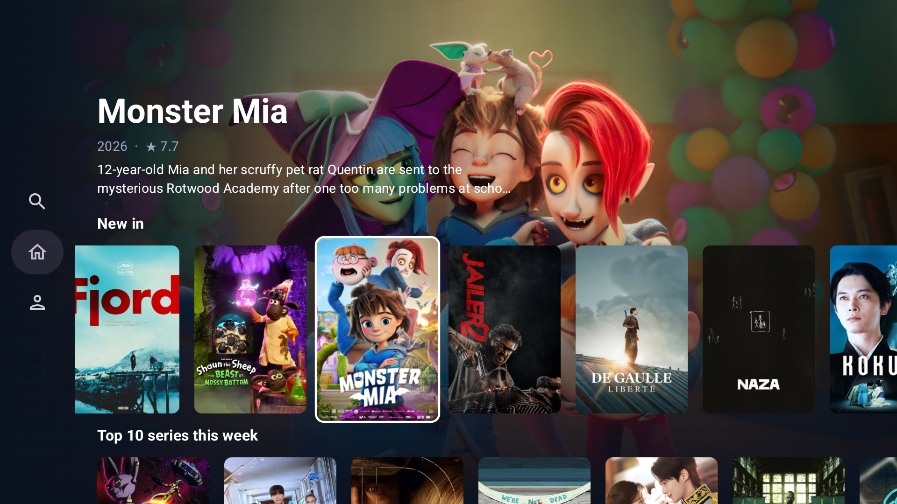
</p>

## Highlights

- **One core, three apps.** Data, repositories, ViewModels and playback live in `:core`. Each form factor only adds its own presentation layer.
- **Android TV with real D-pad focus handling.** Initial focus, focus restoration per row, Back returns to the card you came from, focus-driven backdrop with debounce, rows that keep their title in view.
- **Android Automotive OS.** A parked-only video app: the system blocks it while driving and playback pauses. It reads driving state, gear and speed through the Car API.
- **Media3 `MediaSessionService`.** One player instance shared by the UI through a `MediaController`. Remote media keys, steering-wheel buttons and the media notification work through the session.
- **Adaptive layouts.** The same phone UI switches to a navigation rail, a wide hero and two-pane details on car displays, tablets and phones in landscape.

## Screenshots

### Phone

| Home | Search | Details | Profile |
|---|---|---|---|
| 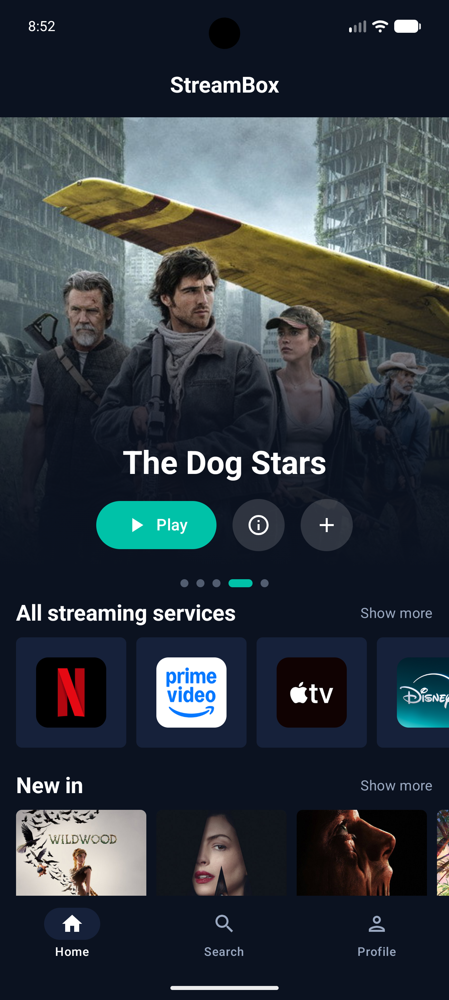 | 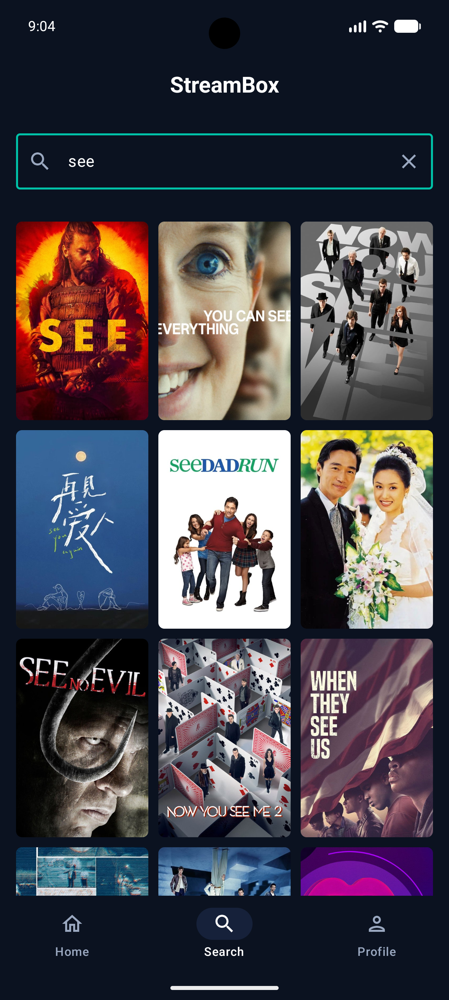 | 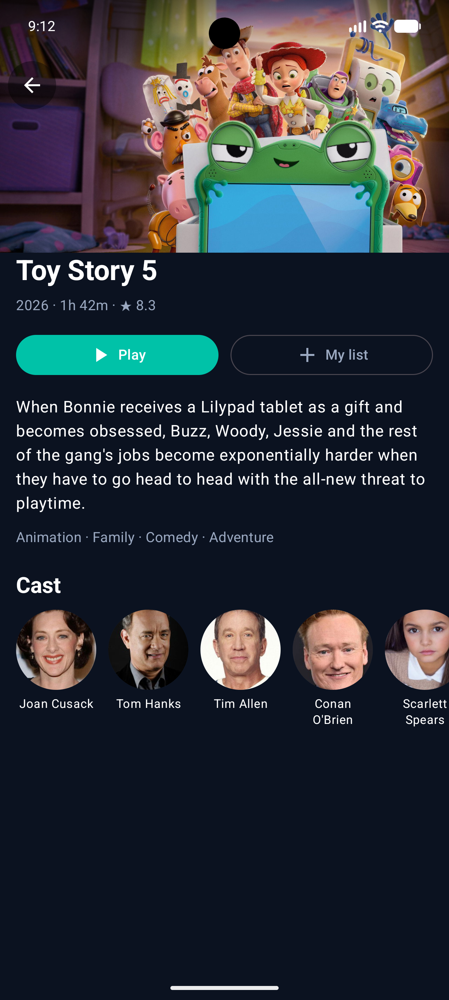 | 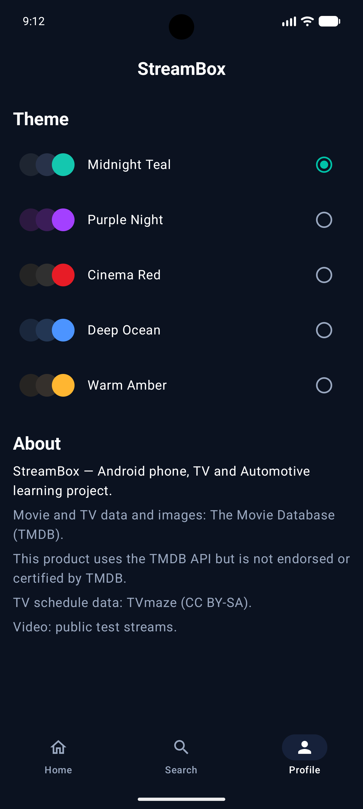 |

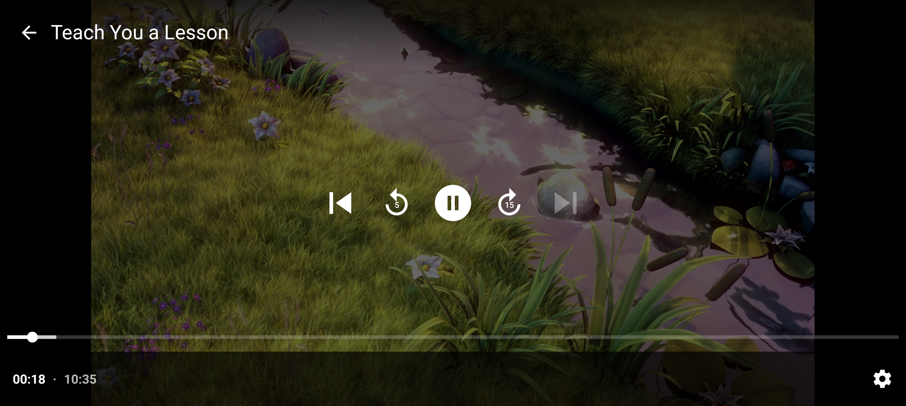

### Android TV

| Home (focus drives the backdrop) | Navigation drawer |
|---|---|
|  | 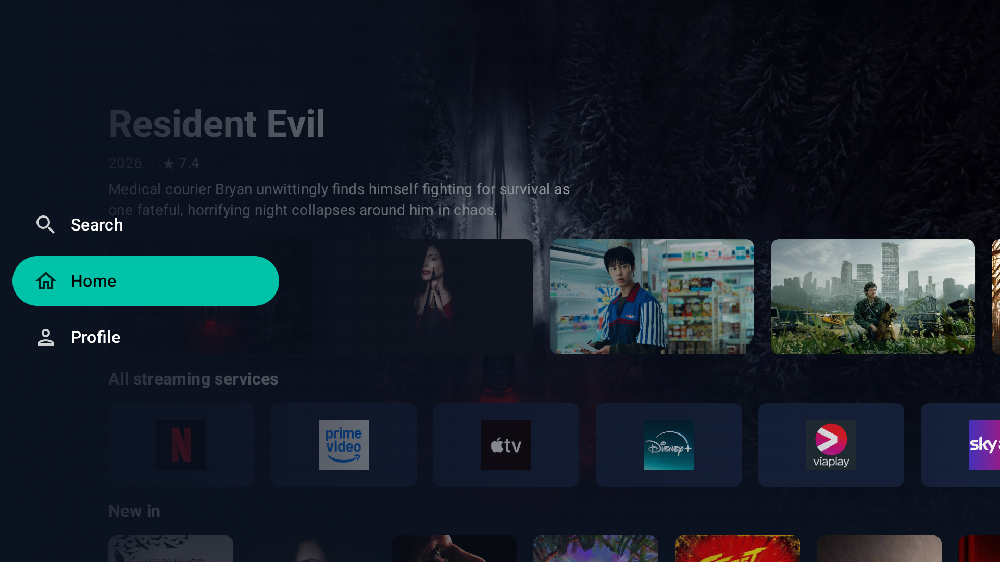 |

| Details (Play focused) | Player |
|---|---|
| 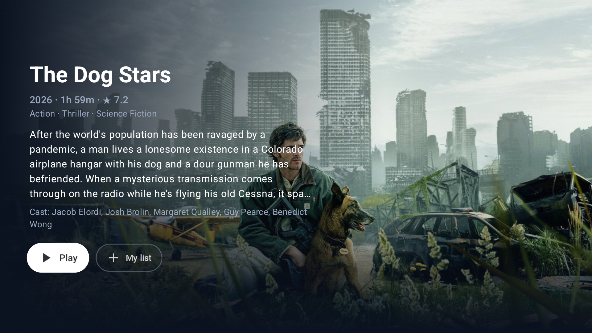 | 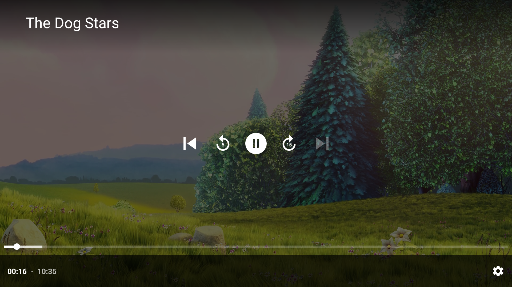 |

| Search | Profile |
|---|---|
| 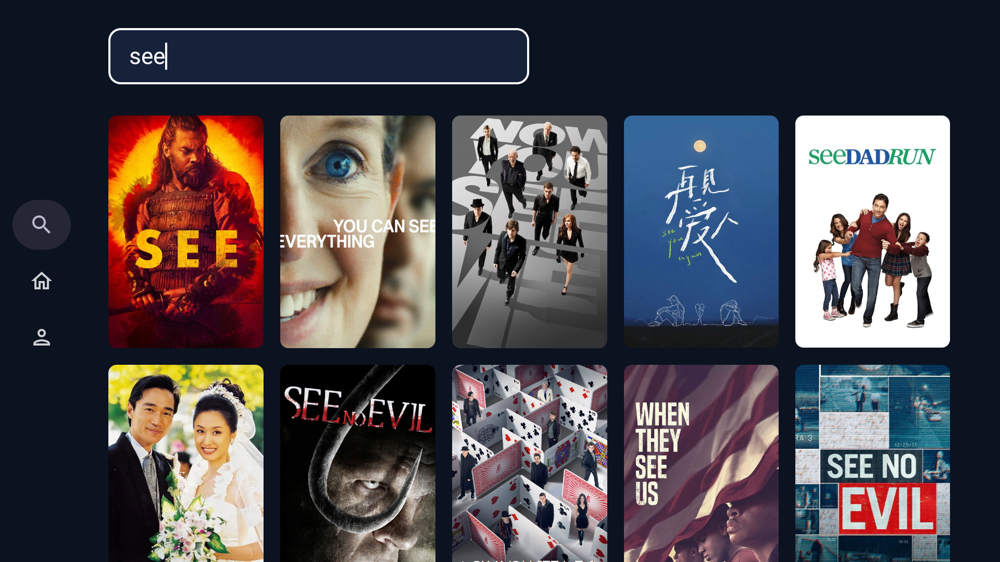 | 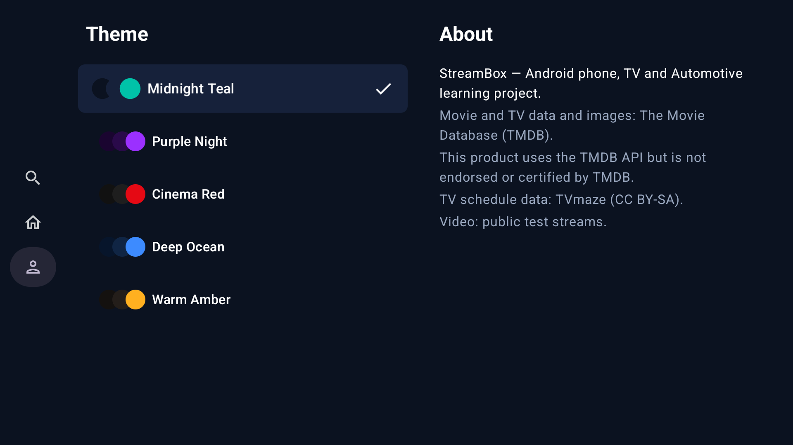 |

### Android Automotive OS

| Home | Details |
|---|---|
| 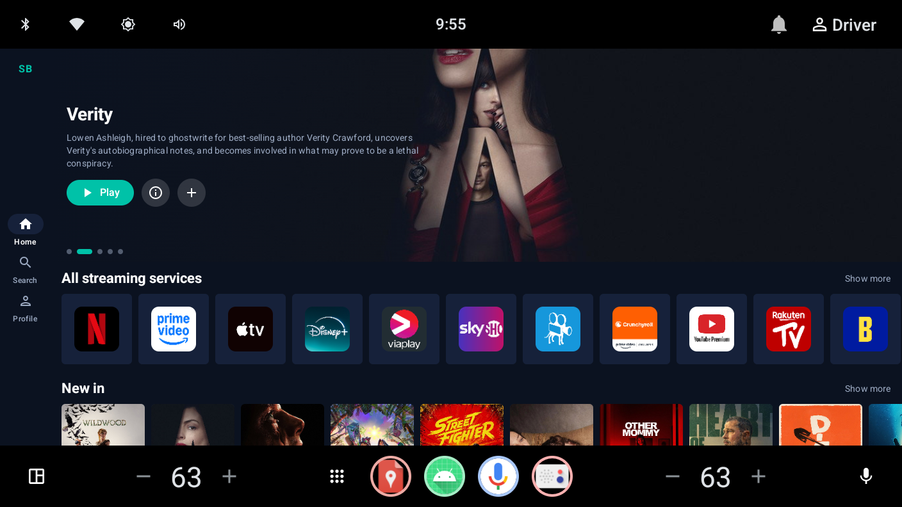 | 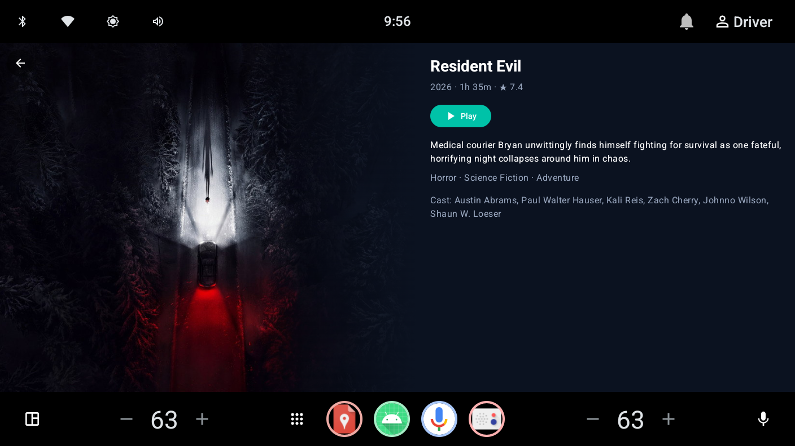 |

| Search | Player (parked) |
|---|---|
| 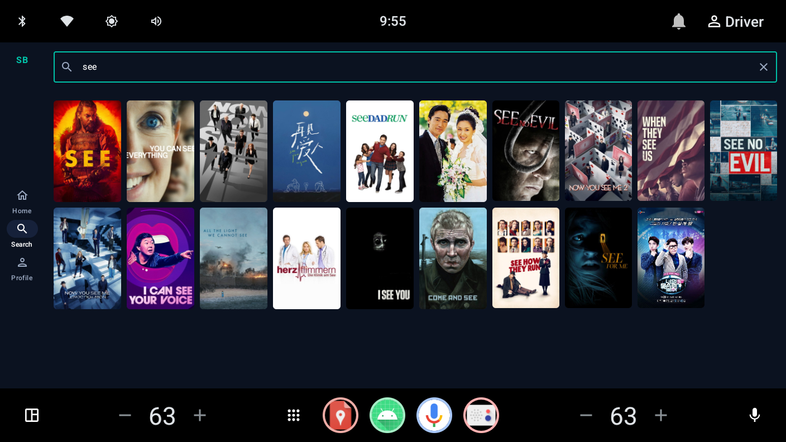 | 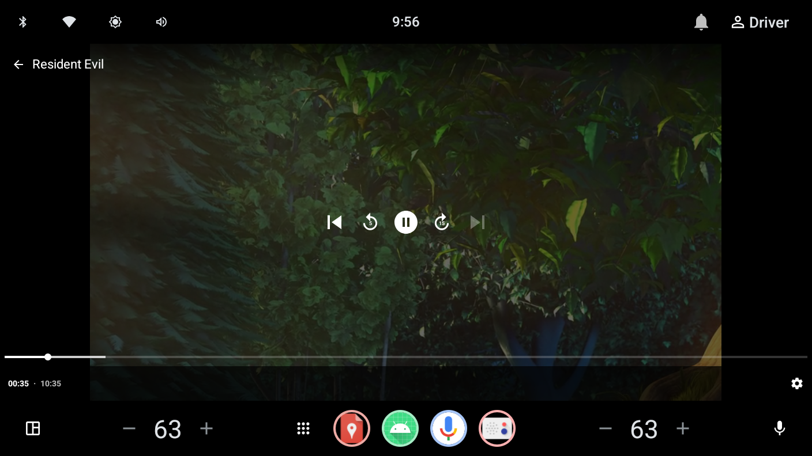 |

| Profile with live vehicle data | Blocked while driving |
|---|---|
| 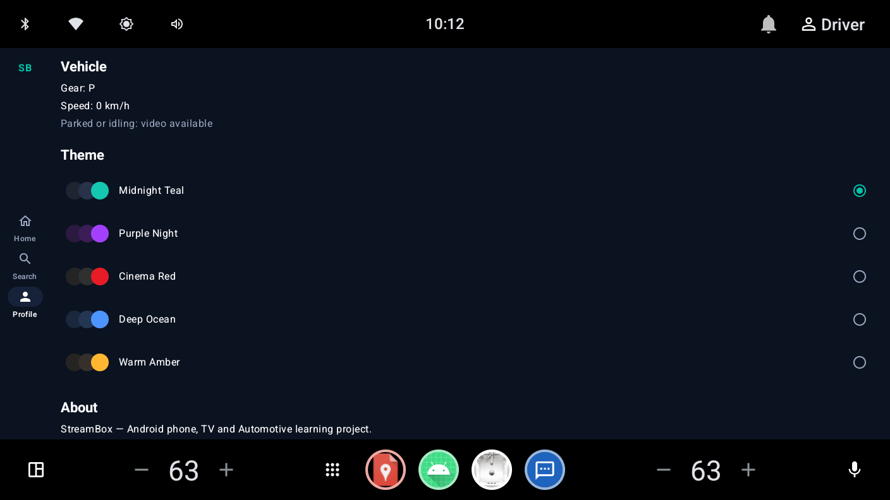 | 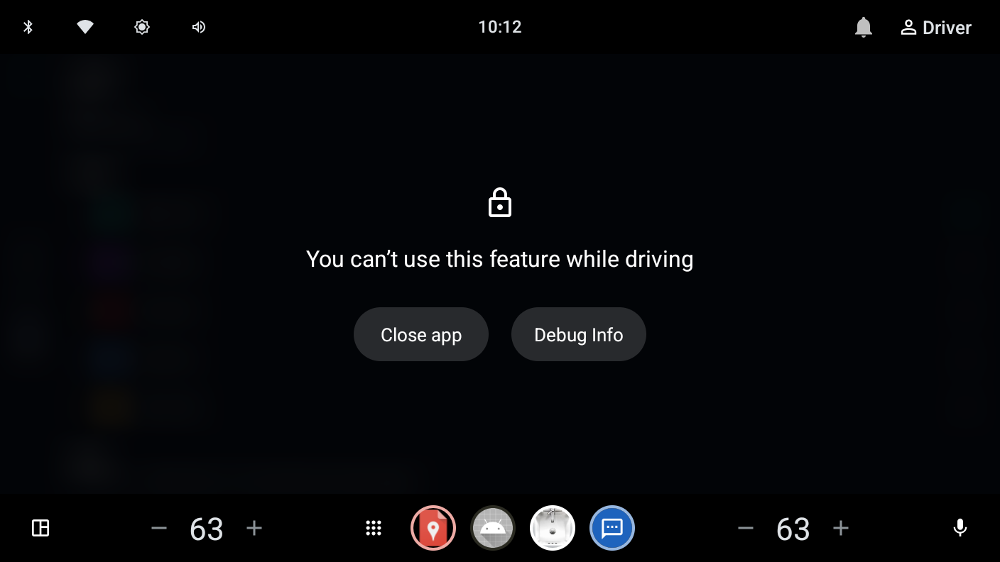 |

## Architecture

```
:core          models · TMDB/TVmaze clients (Ktor) · repositories (Flow)
               shared ViewModels · Media3 PlaybackService · themes (DataStore)
               VehicleStatusSource interface (no car code)
   ▲
   ├── :ui-mobile    Compose screens for touch: home, search, details, player, profile
   │      ▲          adaptive: bottom bar on phones, rail and two-pane on wide screens
   │      ├── :mobile        phone app (manifest, Application, Activity)
   │      └── :automotive    car app + Car API implementation (gear, speed, UX restrictions)
   │
   └── :tv           Compose for TV screens: drawer, focus-driven home, details, player
```

**Car code ships only in the car app.** `:core` declares `VehicleStatusSource` with `@BindsOptionalOf`. Only `:automotive` binds it, so phone and TV get `Optional.empty()` and contain no Car API code.

## Tech stack

| Area | Libraries |
|---|---|
| Language | Kotlin, Coroutines, Flow |
| UI | Jetpack Compose, Material 3, Compose for TV (`androidx.tv.material3`), Navigation Compose (typed routes) |
| Networking | Ktor client (OkHttp engine), kotlinx.serialization |
| DI | Hilt (with `@BindsOptionalOf` for form-factor bindings) |
| Playback | Media3 ExoPlayer (HLS), `MediaSessionService`, `MediaController`, `PlayerView` |
| Storage | DataStore Preferences (theme) |
| Images | Coil 3 |
| Automotive | Car API: `CarUxRestrictionsManager`, `CarPropertyManager` (gear, speed) |

## Implementation notes

**Home feed.** `HomeRepository` emits a `Flow<HomeFeed>`. Each rail loads in turn and the UI updates after each one. A failing rail is skipped instead of failing the whole screen, and `CancellationException` is always rethrown.

**Search.** The query is Compose state converted with `snapshotFlow`, then `debounce(400)`, `distinctUntilChanged()` and `flatMapLatest`, so typing fires one request and a newer query cancels the older one.

**TV focus.**
- `FocusRequester` sets initial focus; `focusRestorer()` returns to the last card in a row.
- The last focused card is saved with `rememberSaveable`, so Back from Details lands on the same card.
- `focusProperties { right = Cancel }` on the last card stops diagonal jumps between rows.
- `BringIntoViewRequester` on each row keeps its title visible while moving along it.
- Backdrop changes are debounced, so holding the D-pad doesn't flood image requests.

**Playback.** The UI never creates a player. `PlayerViewModel` connects a `MediaController` to `PlaybackService`; the service resolves the stream URL from the content ID. Video pauses when the app goes to the background, which is also what pauses it when the car starts driving.

**Automotive.** The activity is not distraction-optimized, so CarService blocks it while driving. `CarVehicleStatusSource` bridges `CarUxRestrictionsManager` and `CarPropertyManager` callbacks into a Flow with `callbackFlow`. `CAR_SPEED` and `CAR_POWERTRAIN` are requested at runtime.

## Run it

1. Clone the repo:
   ```bash
   git clone https://github.com/bhrapratik/StreamBox.git
   ```
2. Get a free TMDB API read access token at [themoviedb.org](https://www.themoviedb.org/settings/api).
3. Add it to `local.properties` in the project root (this file is not committed):
   ```properties
   TMDB_TOKEN=your_read_access_token
   ```
4. Pick a run configuration:
   - `mobile` on a phone emulator
   - `tv` on an Android TV or Google TV emulator (navigate with the arrow keys)
   - `automotive` on an Automotive emulator, API 34+ (`Automotive (1024p landscape)`)
5. On the car emulator, use **Extended controls → Car data** to change gear and speed. Set a speed above 0 to see the app blocked while driving.

## Credits

- Movie and TV data and images: [The Movie Database (TMDB)](https://www.themoviedb.org). This product uses the TMDB API but is not endorsed or certified by TMDB.
- TV schedule data: [TVmaze](https://www.tvmaze.com) (CC BY-SA).
- Video: public HLS test streams (Big Buck Bunny, Blender Foundation).
